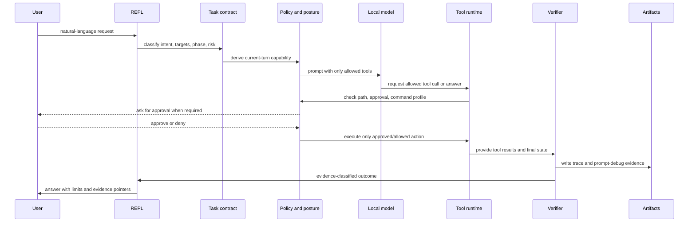
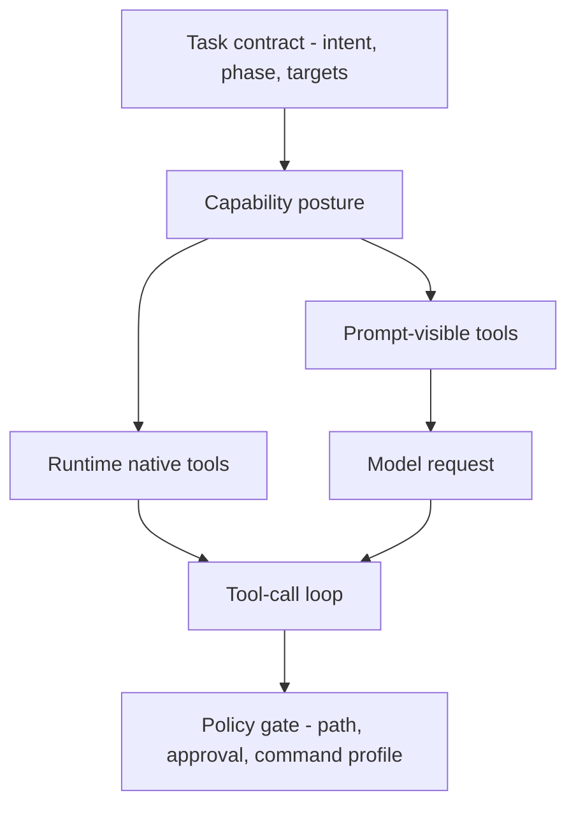
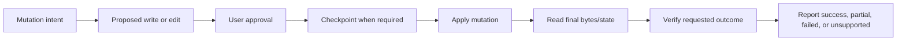

# Execution model

Each natural-language turn moves through a fixed pipeline. The exact class names change over time, but the ownership boundaries should stay stable: classification and policy decide what is allowed; tools perform bounded work; verification decides what can be claimed.

Verification classifies supported action evidence; it does not establish the truth of every model explanation. Read-only prose may remain unverified, and incomplete or unsupported verification stays explicit.

## Turn Pipeline

## Modes And Capability Posture

Public modes are intentionally small:

| Mode | User expectation | Runtime posture |
|---|---|---|
| `auto` | route to the right behavior | chooses a route, then applies the matching posture |
| `ask` | answer or inspect without changes | read-only; no mutation tools; no command execution |
| `plan` | produce an implementation plan | read-only planning; may inspect where policy allows |
| `agent` | perform workspace work | edit-capable with approval and verification |

Legacy names such as `dev`, `chat`, and `unified` are compatibility aliases for `agent`. They should not appear as the main public mode surface.

## Tool Surface Rule

The prompt-visible tool list and runtime-accepted tool list must agree. If a turn is read-only, the model should not see mutation tools and the runtime should reject mutation attempts anyway. This double boundary matters because prompt wording is not security.

## Approval, Checkpoint, Verification

Mutation is not one event. It is a controlled sequence:

Failure at any step should produce an honest failure or partial result. A denied approval is not a policy failure. A model that fails to call a required tool is not evidence that work was done. A verifier failure is not a success with a warning.

## Command Execution

Command execution is deliberately narrower than a shell. Talos should expose `run_command` only when the turn and configured profile allow it. Approval is the last gate, not the only gate: a command outside the visible profile should be rejected before it becomes a user approval question.

Command output may be useful evidence, but it is also model context. Redaction and high-entropy output handling reduce exposure; they do not prove complete secret or PII detection.

## Bounded read-only diagnosis

After complete required reads, an eligible static web diagnosis is finalized through one tools-disabled synthesis. Eligibility is derived from the retained task and supported source relations, not an exact request phrase. The selected route is retained if the response or its evidence association is rejected.

A strict version 9 JSON proposal is requested with a closed JSON Schema on an explicitly capable backend. An unavailable schema capability or invalid schema is rejected before synthesis dispatch. Ordinary response-only synthesis is still requested as text. Required result slots are identified independently by bounded request interpretation. Every immutable slot ID is required as a result key. Recognized diagnosis, selector and explicit script-linkage slots require a fixed evaluation object with null formula and precision values and no operand bindings. These objects request local evidence assessment, not a model support verdict. An unsupported choice is not offered for these slots. Diagnosis and selector slots are assessed only when the request-bound target has one observed match. Duplicate observed label matches leave those results unmet without discarding independently supported siblings. Request-level target ambiguity and invalid catalog targets remain outer-contract rejections.

Calculation and comparison slots retain selection objects or explicit unsupported outcomes. Native catalog IDs are selected for targets, formulas, input occurrences and precision. Calculation selections are scoped to one slot and compatible formula, with that pair's operand IDs and the slot's precision IDs. Unsupported decisions remain unmet, even when other evidence is available. Missing decisions remain distinct from explicit unsupported outcomes. Numerical results are calculated and rendered by the runtime. A fixed evaluation object, schema validity or correct arithmetic cannot establish evidence support or complete request meaning. Formula relevance remains interpretation. Version 6, version 7 and version 8 entry points are retained for historical replay, with separate catalog identities. A legacy format cannot be selected by the current response to bypass version 9 assessment.

Independently recognized calculation clauses are matched one to one. Their operands and precision are checked within the original clause coordinates. Documented and implemented results are assigned distinct required roles. Comparisons are bound to explicit peer slots and compatible supplied inputs. Constant or subset-input expressions can be compared under those bindings. Conflicting bindings and unrelated input sets are not compared. General formula equivalence is not established by equal values at one input.

The catalog is bound to the original request and normalized retained observations, not original file-byte offsets. The generation schema is a structural projection, not the complete runtime contract. Candidate size and output-token limits remain independent. Serialized read membership is checked against the complete request with a nesting limit of 35, covering the accepted schema depth of 32 and its three enclosing objects. Duplicate properties, changed tool results and excess input limits are rejected. Missing evidence cannot be replaced by a current disk read or another generation. Unknown regions and omitted results remain unresolved. Independently supported sibling results may be retained after a result-level rejection. Malformed JSON or an invalid outer contract is rejected as a whole.

Every unknown result requires one interpretationDecisions key in addition to its result key. In the current contract, both values are restricted to unsupported. No supplemental source relation is offered as a substitute for unknown request meaning. Missing interpretation decisions remain distinct from explicit unsupported outcomes. Original slots cannot be replaced or displaced, and unknown regions continue to prevent strict completion.

Supplemental relation selection is retained in version 6 replay only. Missing-ID diagnosis, replacement selector and declared-script distinction are separate relation kinds with exact source identities. Eligible unknown regions require an unambiguous local target mention or an unambiguous target inherited from structurally eligible request regions. Region and relation IDs are paired in that schema and independently rebound during assessment. The worst-case selected observations must fit the eight-observation and 32-component limits before generation. Structural exclusions are applied conservatively, without establishing semantic relevance. Supplemental observations are marked as model-attributed, and their relevance is explicitly left unestablished. Ordinary wording support is not established merely by retaining useful observations.

In that legacy replay, repeated supplemental facts are grouped only for presentation using their catalog, kind, target and ordered source identities. All associated regions, original requirements and decision statuses remain separate assessment and trace records. Required calculations and unsupported components are not grouped. Privacy shaping and output limits remain controlling, and grouping cannot establish coverage.

Interpreted coverage, checked references, bounded calculation and intact delivery are recorded separately. READ_ONLY_ANSWERED remains ordinary explanation completion, with action verification NOT_RUN. Semantic interpretation is not certified by JSON validity or arithmetic correctness. Privacy withholding and output removal remain controlling.

## Ordered document comparison

The numerical comparison slots above remain separate from document comparison. `DocumentComparisonRequest` binds ordered operands from bounded current-request regions. Quotes, examples, negation and conditional envelopes cannot grant comparison authority. A separate conservative vocabulary check can mark an unsupported document-comparison region unresolved, but cannot authorize paths. This is a bounded language contract, not complete natural-language interpretation.

`talos.compare_documents` passes both source paths through the ordinary permission boundary. `DocumentPairAdmission` admits both operands before either read and retains raw and text identities. `TurnAuditCapture` couples the resulting current-turn receipt to the actual `DocumentTextDiff` computation. Successful model prose or a fabricated tool-result string cannot recreate this record. Stale, reordered, substituted or duplicate observations do not complete a required comparison.

`DocumentComparisonAnswer` selects the typed ordered result and retains separately requested numerical and diagnostic components. Mixed answers must bind both comparison snapshots to the earlier read projections used for those sibling results. Read projections are not presented as exact original bytes. Comparison display completeness and required explanation are assessed independently. Limited display, unsupported meaning, changed read evidence and unsupported source structures remain incomplete. Successful or uncertain mutation evidence prevents the read-only unchanged-workspace footer from being constructed.

Source explanations are limited to the closed JavaScript structures described in [the user command guide](../user/commands.md#document-comparison). Code is parsed, not executed. PDF and DOCX cover extracted text only. Paired content restrictions follow model handoff, final presentation, debug capture, memory and saved sessions. Denied content in Talos history and debug projections is replaced by fixed notices, while permitted local display remains available. No derived comparison indexer is enabled.

For managed llama.cpp requests that permit model access but deny raw artifacts, owned stdout and stderr retention is disabled before dispatch. Draining continues without retention for the manager lifetime, including replacement processes. Suppression leaves earlier log bytes unchanged. The existing per-port log reset on a later launch is not changed. Native file or prompt-directory logging and unavailable capture control prevent restricted dispatch. Connect-only llama.cpp cannot establish owned capture control and rejects such requests. This is an owned-sink guarantee, not proof of an arbitrary endpoint's identity or external retention policy.

For eligible mixed diagnoses, complete reads are followed by a required comparison-tool continuation before tools-disabled answer synthesis. Existing iteration, evidence and generation limits remain controlling. Oversized read-only requests cannot acquire complete request coverage merely by falling outside the bounded interpreter.

## Trace And Prompt Debug

Trace and prompt-debug artifacts exist to answer three questions:

1. What mode, posture, and tool surface did this turn use?
2. What did the model ask the runtime to do?
3. What evidence supports the final answer?

These artifacts are local evidence, not tamper-evident records. They are for debugging, audit, and release QA.
