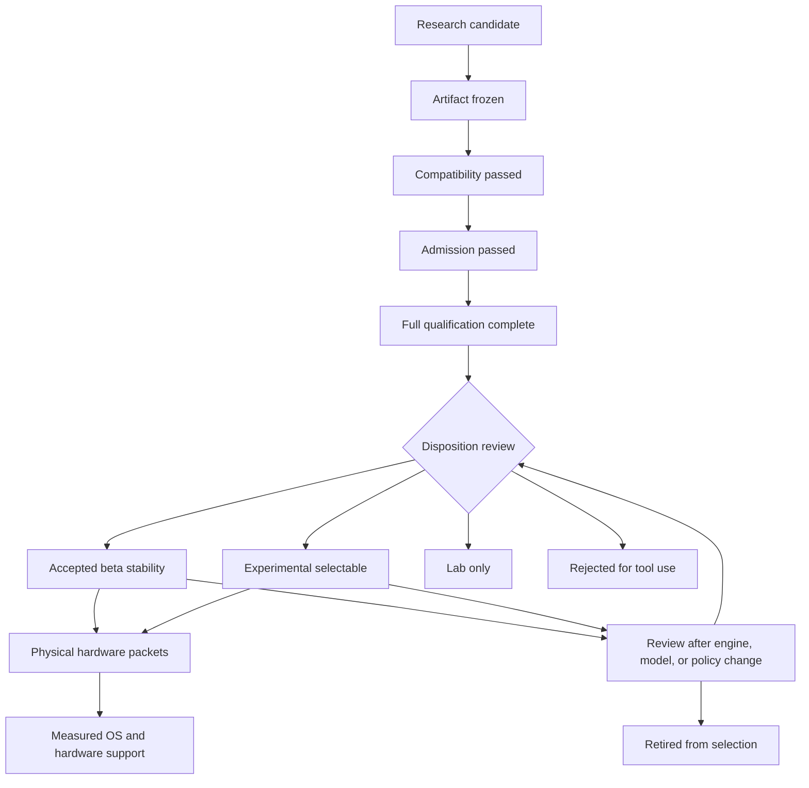

# Model profile lifecycle

A model moves through Talos in three separate tracks. Evidence records what was tested. Product disposition controls what Talos may present as selectable. Hardware support records where the exact profile has been measured. Evidence progress is not a product disposition. Model quality and hardware support are separate decisions.

Passing admission is not a support claim. A model that starts, answers a smoke prompt, or completes one edit has only passed that event. It has not earned a profile or hardware label.

## Lifecycle map

The arrows describe allowed progress, not automatic promotion. Every transition is reviewed against the evidence named below.

## Three kinds of state

### Evidence progress

Evidence progress lives in ignored local packets under `local/model-qualification`. It answers how far a candidate was tested.

| State | Owner | Entry rule | Exit rule | Required evidence | Public meaning |
| --- | --- | --- | --- | --- | --- |
| research candidate | local research record | a primary source and a Talos use case are identified | exact source and license are chosen | source links, intended role, license notes | none |
| artifact frozen | candidate packet | source revision, bytes, size, SHA-256, license, and conversion lineage are fixed | engine preflight begins | immutable candidate JSON and local hash proof | none |
| compatibility passed | preflight packet | the exact engine loads the artifact and exposes the declared text, template, reasoning, and tool behavior | admission begins | engine identity, `/props`, direct tool matrix, logs | none |
| admission passed | 12-trial admission packet | all trust and completeness gates pass and the admission scorer passes | a fresh full campaign begins | 12 valid trials, validator output, scorecard | none |
| full qualification complete | 72-trial full packet | all required trials, finalizers, and scorecard are complete | disposition review records a decision | 72 valid trials, finalizers, validator, scorecard | evidence for review, not automatic support |

An evidence state never makes a profile selectable by itself.

### Product disposition

Durable profile data belongs to `LlamaCppModelCatalog`. The catalog binds the exact artifact, runtime defaults, compatible engine lanes, qualification packet, Talos commit, scorecard hash, and user guidance.

| Disposition | Selectable | Wizard download | Meaning |
| --- | --- | --- | --- |
| accepted beta stability | yes | permitted | the exact profile meets the current beta evidence contract or carries an explicit legacy record |
| experimental selectable | yes | no | the exact profile has useful bounded evidence but is not a beta default |
| custom unverified | no catalog selection | no | a user supplied model can run, but Talos makes no qualification claim |
| lab only | no | no | provenance, engine behavior, model quality, or hardware fit blocks a selectable claim |
| rejected for tool use | no | no | the tested configuration failed the Talos tool-use contract |

`LlamaCppModelCatalog` owns every durable disposition. Transition rules are explicit:

| Disposition | Entry rule | Exit rule | Required evidence |
| --- | --- | --- | --- |
| accepted beta stability | full review meets the accepted contract, or an existing profile carries an explicit legacy record | requalification, demotion, replacement, or retirement | exact catalog record and reviewed current or legacy packet |
| experimental selectable | full review meets the experimental contract but not accepted beta | requalification, promotion, demotion, or retirement | exact catalog record and reviewed full packet |
| custom unverified | user supplies a model outside a qualified catalog projection | exact candidate enters the qualification lifecycle | configured path and explicit unverified label |
| lab only | compatibility, provenance, quality, or hardware blocks normal selection | blocking condition is resolved through new evidence | packet naming the blocking condition |
| rejected for tool use | the tested configuration fails its tool-use contract | a materially new model or runtime identity starts fresh | scorecard or preflight evidence with rejection reason |

`retired` is a lifecycle outcome, not a current `LlamaCppModelCatalog.Disposition` value. Today retirement means removing the profile from selectable catalog records and preserving the reason in release history or the replacement review. Adding a durable retired enum requires a separate runtime change and migration plan.

Only accepted beta stability and experimental selectable profiles belong in normal profile selection.

### Hardware support

Hardware support is a matrix over the exact profile and machine lane.

| Dimension | Required evidence |
| --- | --- |
| model | repository revision, artifact, quant, size, and SHA-256 |
| engine | llama.cpp tag, executable hash, backend, driver, and launch arguments |
| operating system | exact Windows, Ubuntu, or WSL identity |
| processor | CPU model, core count, memory capacity, and memory layout |
| accelerator | GPU model, VRAM, driver, and measured offload |
| runtime | context, sampling, output caps, timeout, and tool mode |
| fit | load time, first token, prompt rate, generation rate, RAM, VRAM, paging, and stability |

Low, Medium, and High are summaries of completed physical packets. They are not derived from parameter count, GGUF size, one virtual machine, or one reference GPU.

A profile can be experimental selectable with no public Low, Medium, or High label. That is a valid state.

## Promotion rules

Promotion is a reviewed projection from local evidence into the catalog.

Before projection, require:

1. exact artifact and conversion provenance
2. compatibility proof on the pinned engine
3. immutable calibration created before trial one
4. a valid admission packet
5. a valid full packet or an explicit legacy record for an existing profile
6. a mechanical scorecard and reviewer finalization
7. a catalog entry whose runtime ceiling matches the tested configuration
8. setup, status, doctor, tool-surface, trace, and documentation tests

The catalog is a capability ceiling. Runtime evidence may preserve or narrow it. Runtime evidence never expands it.

## Legacy evidence

Legacy evidence remains legacy until a current protocol packet replaces it. Existing beta profiles may keep an explicit `legacy:` packet identifier. That label records the evidence level honestly. It does not become current-protocol evidence because a newer candidate passed the current harness.

Migration requires a fresh immutable campaign for the exact artifact, engine, runtime configuration, and hardware lane. The new catalog record must carry the new protocol revision, Talos commit, scorecard hash, and packet identity.

## Demotion and retirement

Review a selectable profile again when any of these facts change:

- source artifact or quant
- engine version or template behavior
- tool schema or parser behavior
- reasoning mode
- context or sampling defaults
- timeout or output-cap policy
- approval, verification, or trace contract
- a confirmed trust defect that affects its evidence

Demote the profile when its recorded capability is no longer supported by current evidence. Use lab only or rejected for tool use when that state is accurate. Retire it from normal selection when it is superseded, unavailable, legally unusable, or no longer maintainable.

Never erase the reason for a demotion. Never reuse an old packet for changed bytes.

## Worked examples

### Quartz 4B stops after admission

Quartz 4B is chosen from an official Apache-licensed repository. Its artifact is frozen and the pinned engine loads it. Admission then shows repeated malformed required-tool calls. The campaign records `ADMISSION_FAILED`. Quartz remains a local research candidate. It is not added to the catalog and receives no hardware label.

### Basalt 8B becomes experimental

Basalt 8B freezes cleanly, passes compatibility, passes admission, and completes 72 full trials. Its score meets the experimental threshold but misses accepted beta requirement coverage. The reviewed catalog projection marks it experimental selectable and pins the exact packet. A separate physical Windows CUDA packet supports one measured GPU lane. CPU and Linux remain unclaimed.

## Ownership boundary

| Concern | Owner |
| --- | --- |
| durable artifact, runtime, evidence, and disposition | `dev.talos.engine.llamacpp.LlamaCppModelCatalog` |
| effective runtime identity and capability ceiling | llama.cpp adapter profile resolver |
| local campaign schemas and scorecard | qualification harness |
| current public profile guidance | `docs/reference/model-profiles.md` |
| repeatable qualification procedure | maintained model qualification runbook |

The lifecycle adds no model-family strategy layer. Family-specific facts belong in catalog data, calibration, and evidence until repeated implementation pressure proves a shared abstraction is necessary.
