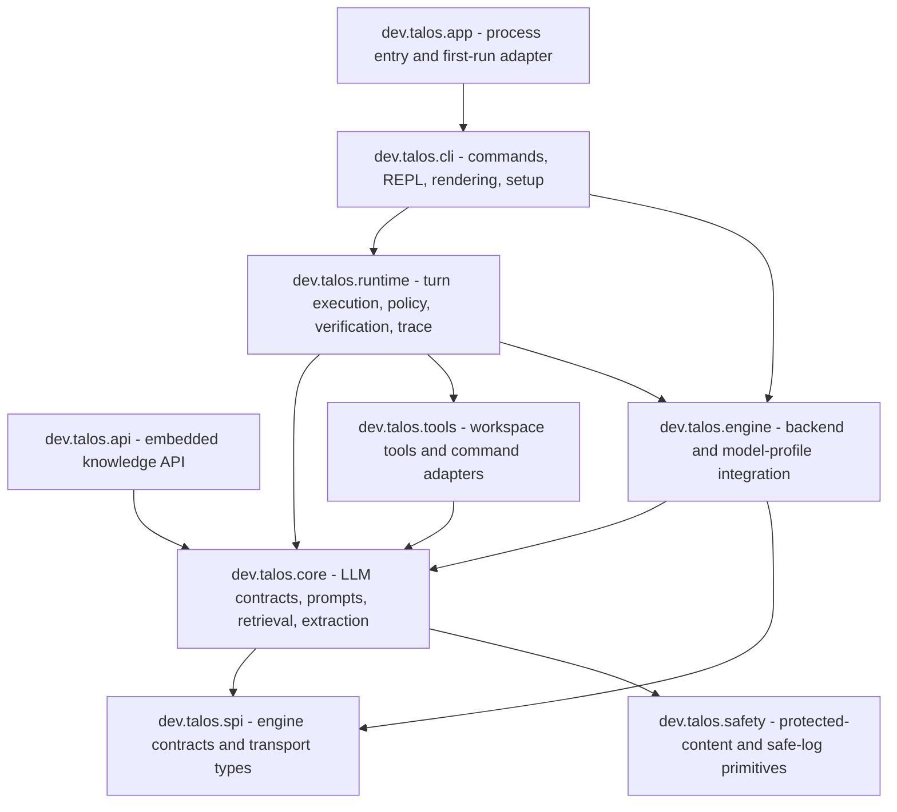
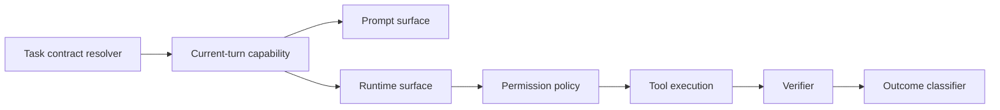

# Package map

This map names all nine current top-level production packages under `src/main/java/dev/talos`. It is an ownership map, not a generated dependency graph or proof that every package boundary is enforced. The arrows below are selected implementation dependencies, not an exhaustive layering specification.

## Package Responsibilities

| Package | Responsibility | Typical classes or areas |
|---|---|---|
| `dev.talos.api` | embedded knowledge-service facade | `TalosKnowledgeEngine`; programmatic indexing, retrieval and privacy controls |
| `dev.talos.app` | process entry and terminal first-run handoff | `Main`, `TerminalFirstRun`; delegates user-facing execution to CLI adapters |
| `dev.talos.cli` | user-facing commands, REPL loop, mode selection, setup, status, rendering | command classes, mode handlers, prompt-debug commands, terminal UI |
| `dev.talos.core` | model contracts, prompt construction, retrieval, document extraction, shared core types | LLM client abstractions, prompt builders, index/retrieval, extraction adapters |
| `dev.talos.runtime` | turn execution, policy, tool-call loop, evidence handling, verification, outcome classification | tool-loop orchestration, permission policy, evidence obligations, trace capture |
| `dev.talos.tools` | bounded local operations | read, grep, edit, batch workspace mutation, command profile execution |
| `dev.talos.engine` | backend-specific startup and model profile integration | managed llama.cpp, profile catalog, health checks, backend capability discovery |
| `dev.talos.safety` | lower-level protected-content, path-token and log-sanitization primitives | `ProtectedWorkspacePaths`, `ProtectedContentSanitizer`, `SafeLogFormatter` |
| `dev.talos.spi` | provider-neutral engine, embedding and corpus contracts and transport identity types | `ModelEngine`, `ChatModelEngine`, `CorpusStore`, `ProviderTransportAttempt` |

`dev.talos.safety` is not the complete filesystem or authorization boundary. `dev.talos.core.security` owns `Sandbox`, `WorkspaceContainment` and `NoFollowPathPolicy`; `dev.talos.core.io` owns atomic file-writing mechanics; runtime policy and concrete tools consume these components. Keep their responsibilities distinct when tracing a safety guarantee.

## What the architecture gates enforce

`validateArchitectureBoundaries` in `build.gradle.kts` scans source references for six selected rules and compares them with `config/architecture-boundary-baseline.txt`. Both new forbidden references and stale baseline entries fail the ratchet. It is not a general cycle detector or proof that every dependency is intended.

| Source rule | Forbidden dependency |
|---|---|
| `runtime-core-no-cli` | runtime or core to CLI |
| `core-no-runtime` | core to runtime |
| `tools-no-runtime` | tools to runtime |
| `engine-no-runtime` | engine to runtime |
| `safety-no-talos-layers` | safety to app, CLI, core, engine, runtime, SPI or tools |
| `spi-no-upper-layers` | SPI to CLI, core, runtime or tools |

`LayeredArchitectureTest` applies bytecode-level versions of those six rules, plus five selected rules: runtime policy to CLI, runtime verification to CLI, runtime tool-call code to CLI REPL, tools to CLI, and SPI to app. These checks can detect type-level dependencies beyond textual imports. The first three additional rules refine existing restrictions; they do not constitute three new global layers.

Neither rule set supplies a complete allowed-dependency matrix. In particular, the named source rules do not constrain `api` ownership, and the safety rule's explicit forbidden list does not include `api`. A passing ratchet or ArchUnit run establishes only its declared rules for the inspected source/bytecode, not complete architectural correctness. Report-only architecture discovery is supporting analysis, not an additional enforcing gate.

## Ownership Rules

- CLI rendering may explain a decision, but it should not make the trust decision.
- Prompt construction may describe allowed tools, but it should not authorize tools independently of runtime posture.
- Workspace tools must assume path and approval policy can fail closed.
- Engine code should report backend capabilities; it should not broaden product claims.
- Verification should inspect final state and evidence, not infer success from assistant prose.

## Refactor Pressure Points

Talos should continue moving policy out of large orchestrators and into named components. The target shape is:

The key invariant is single-source capability derivation: prompt-visible tools and runtime-accepted tools should come from the same current-turn capability, so Ask and Plan cannot drift into write-capable wording or behavior.
