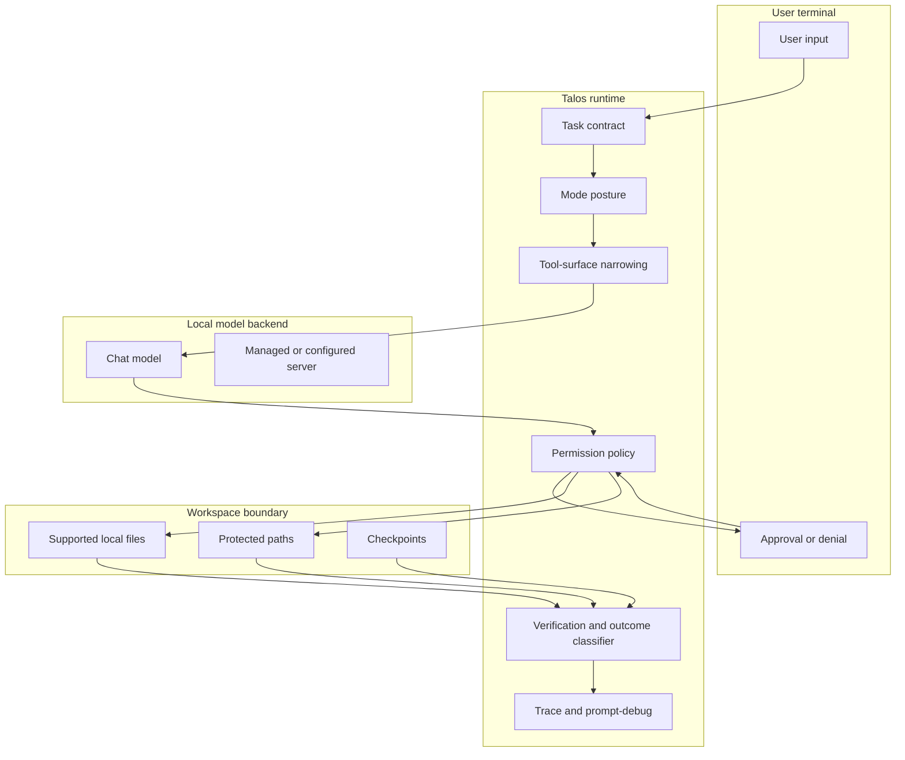

# Trust boundaries

Talos treats the model as an untrusted planner. The runtime owns authority. Trust boundaries are therefore implemented as concrete checks around paths, tools, approvals, commands, artifacts, and final claims.

At provider EOS, projection may retain a complete static HTML element byte-for-byte inside an unambiguous, single-line, single-backtick code span. This bounded exception excludes active tags/attributes, entities, controls, cross-boundary markup, and textual tool proposals; ambiguous input retains the existing sanitizer behavior. Shared prompt and terminal sanitizers are unchanged. Receipt completion, normalization, selected native proposal identity, tool surface, one-use authority, mode/path policy, and approval remain independent requirements: preserving an inert prose literal grants no execution permission by itself.

## Boundary Map

## Boundary Table

| Boundary | What it protects | Primary failure it prevents |
|---|---|---|
| Workspace containment | reads, writes, deletes, checkpoints, batch operations | path escape through aliases, junctions, or sibling-prefix confusion |
| Protected-path classification | `.env`, credentials, SSH keys, package tokens, local private material | accidental protected read or protected-content handoff |
| Mode and posture narrowing | Ask and Plan read-only behavior | model sees or uses tools the current mode should not expose |
| Approval gate | mutation and bounded command execution | unapproved local changes or command execution |
| Command profiles | shell-adjacent behavior | arbitrary command execution through a general prompt |
| Checkpoints | rollback for risky mutation lanes | approved write leaves no recovery path where policy required one |
| Verification | outcome truthfulness | final answer claims success without matching file or command evidence |
| Runtime artifacts | auditability | no way to inspect what the turn actually did |

## Answer interpretation boundary

Within the bounded read-only web diagnosis route, a model proposal is treated as untrusted interpretation. Native catalog identities, strict fields and retained-source bindings are checked locally. Model-calculated values, completion verdicts, permissions and free-text answer paragraphs are not accepted into that contract.

Each result is assessed against its independently retained request slot and evidence. A broad reference cannot satisfy several recognized calculation clauses. Definition, implementation and comparison roles cannot be exchanged. Complete semantic interpretation is not proven by submitting valid references. Unknown regions and omitted results prevent strict completion. Legacy aggregate request parsing remains unchanged for other consumers.

Association is established by authentic references, not relevance or truth. An obsolete or unrelated formula can be referenced correctly and still be interpreted incorrectly. Those errors remain acceptance failures. The selected expression and supplied operands are checked by bounded arithmetic, without JavaScript execution or observed application output.

In the current version 9 contract, recognized diagnosis, selector and explicit script-linkage slots require fixed evaluation objects. No model-authored support verdict or unsupported choice is accepted for these slots. Support is established only by local assessment of retained evidence, and a fixed object can still produce an unmet result. Diagnosis and selector slots are assessed only when the request-bound target has one observed match. Duplicate observed labels cannot be disambiguated by the model's preferred target, while independent sibling results remain assessable. Request-level target ambiguity and invalid catalog targets remain outer-contract rejections. Calculations and comparisons retain explicit selection or unsupported choices. Unsupported results remain unmet, including comparisons whose peer evidence is available. Unknown regions require unsupported in both result and interpretation accounting. Missing decisions cannot be treated as unsupported selections or successful coverage. Version 8 decision assessment remains available for historical replay and cannot replace the selected version 9 runtime route.

Supplemental interpretations are retained in version 6 replay only. They are bound separately to exact unknown regions and runtime-owned typed source relations. Every unknown region requires a selected relation or explicit unsupported decision. Missing decisions are retained separately. Diagnosis, replacement selector and script distinction retain their own source and target bindings. Relation kinds and source identities are obtained from the authenticated catalog, not from model authority fields. Their proposed relevance is not accepted as proof of request meaning. Known slots, formula roles, input bindings and unknown placeholders cannot be changed by a supplement. Structural exclusions and inherited target mentions are not a general intent detector. Repeated facts may be grouped for display, while each region association and unresolved requirement remains in assessment and trace evidence. Original unresolved regions remain unmet, and supplemental observations cannot create completion or execution authority.

The selected response, turn, workspace and retained observations are bound together before assessment. Rejection does not restore unchecked prose. Denial, mutation, cancellation and privacy outcomes are not overridden by an interpreted answer. Required content removed from local delivery is not restored, and completion is downgraded. Intact permitted local delivery is assessed separately from history retention. Deliberately withheld history does not by itself downgrade that delivery or grant persistence permission.

## Protected Reads

Protected reads are different from normal workspace reads. A direct approved protected read may enter model context in default developer behavior. In private mode, approved protected reads should stay local-display-only unless explicit send-to-model scope is enabled.

Indirect retrieval is a separate path. Grep, retrieval snippets, and RAG indexes must not become a way to smuggle protected content into context.

## Artifact And Redaction Limits

Secret redaction is best-effort. It covers common key-value secret shapes, known token forms, PEM private-key blocks, JWT-like tokens, AWS access-key shapes, and URL userinfo patterns in the sinks that use the redaction pipeline. This is not complete secret, credential, or PII detection.

run_command stdout and stderr pass through the model-context handoff boundary when command output is needed for verification. High-entropy streams and recognized secret shapes may be withheld or summarized before model handoff, but this is not a complete command-output privacy proof.

Local traces and logs are durable evidence artifacts, but they are not tamper-evident. A reviewer should treat them as useful local records, not cryptographic proof.

## Remote Endpoint Boundary

Chat model endpoints are localhost-gated by default. Non-localhost chat endpoints are rejected unless the backend configuration explicitly allows remote use. If remote chat is explicitly allowed, prompts can leave the machine.

## File Format Boundary

Talos beta is strongest on text-oriented developer workspaces. PDF, DOCX, and workbook support is extraction-oriented. Scanned PDFs, layout-perfect document understanding, tracked changes, embedded objects, charts, macros, and formula recalculation remain limited. Image/OCR and PowerPoint are outside the beta product claim.
