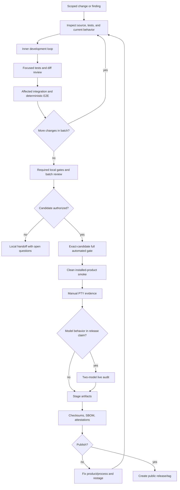

# Work-Test Cycle

Talos work is separated into an inner development loop and a Release QA Gate. Focused checks support individual edits. Required local gates are completed before a coherent batch is accepted. A full release packet is reserved for candidate acceptance, not repeated after every edit.

## Loop Map

## Inner Development Loop

During implementation or debugging:

1. Branch, version and working-tree state are confirmed.
2. The objective, preserved invariants, affected boundaries, acceptance checks and stop conditions are stated briefly.
3. Source and callers are inspected. The failure is reproduced through the real affected boundary where possible.
4. A coherent correction and focused regression coverage are implemented.
5. Focused checks and `git diff --check` are run. The intended cause of each failed assertion is checked before its expectation is changed.
6. Adjacent integration and relevant deterministic E2E checks are run before scope is widened, especially for authority, persistence and shared policy.
7. Required local gates and independent review proportional to risk are completed before batch acceptance.

Full Gradle `check` is required before a batch touching runtime behavior, release wiring, public documentation contracts or shared policy is accepted. Affected architecture, privacy and release validators are run earlier when those boundaries change. Focused checks alone are not full local acceptance. Patch versions are not bumped for each inner-loop edit.

The `test` and `e2eTest` tasks cover separate source sets. The `check` task additionally requires coverage, architecture, release-ledger and generated-artifact checks. A selected unit suite is not described as deterministic E2E or live-model validation.

For documentation-only navigation or workflow housekeeping, links, consistency, whitespace and preservation are checked. Product suites are not rerun unless executable behavior or a public behavior contract is affected.

## Bounded Batch Record

One short record is maintained for each coherent outcome. Existing checklists or tickets are reused rather than duplicated.

- Objective and observable acceptance criteria.
- Invariants and affected producer, consumer and side-effect boundaries.
- Evidence identity, commands and results, including failures, errors and skips.
- Synthetic assumptions, untested behavior and remaining questions.
- Next action and any new authority needed for external or destructive changes.

Existing failed runs and closed reports are preserved. Current status is updated separately. Green summaries and process exit codes are checked against underlying results. In particular, reporting-oriented candidate test tasks can finish with exit code zero while test failures remain.

A completed offline batch is distinguished from installed-product, live-model and exact-candidate acceptance. Broader claims are not inferred from a passing subset.

## Release QA Gate

Release decisions require evidence that belongs to the exact candidate SHA. Stale local builds, dirty-tree runs, or old installed binaries are stabilization evidence only.

Artifact taxonomy:

| Artifact type | Meaning | Public? |
|---|---|---|
| Local staging artifact | built locally for developer smoke and inspection | no |
| CI staging artifact | built by release staging workflow for QA review | no |
| Public release artifact | attached to a GitHub Release or otherwise advertised as installable | yes |
| Draft release asset | a GitHub Release asset attached before publication; a draft GitHub Release asset is not safe pre-QA evidence | treated as public for safety |

Before publication, require:

- full automated gates for the candidate
- machine-readable quality summaries and `qualityReportGate`
- clean installed-product smoke from the candidate artifact
- manual PTY transcript for real terminal behavior
- large-scale live audit when model behavior is part of the release claim
- runtime artifact canary scan for manual evidence roots when artifacts exist
- checksum, SBOM, and attestation verification for staged artifacts
- named exclusions for any skipped release gate

Do not publish release assets from stale, dirty, or unreviewed evidence.

## Evidence Quality

Evidence must name:

- branch and commit SHA
- candidate version
- executable actually invoked
- installed path or artifact path
- backend and model profile
- workspace root
- Talos home when isolated
- commands run and their result

For live audits, save prompt-debug and trace evidence after natural-language turns. For mutation lanes, save final file state and workspace diff. For release staging, verify the staged manifest and artifact checksums before treating the artifact as release-ready.

Generated Markdown quality reports are local reviewer snapshots. They help humans read the evidence, but they do not replace the underlying JSON summaries, test results, staged manifests, or manual audit packet.
